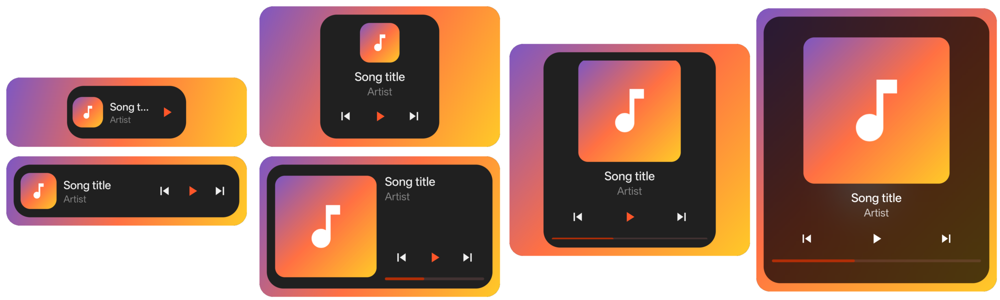

# Media Widget

[](https://github.com/Meo98/media-widget/releases/latest)
[](https://github.com/Meo98/media-widget/releases)
[](LICENSE)
[](#requirements)

A home screen widget that shows and controls whatever is playing on your phone,
in **any media app**: Spotify, Tidal, YouTube Music, Pocket Casts, audiobooks, VLC,
KDE Connect and everything else that registers a media session.

No account, no ads, no internet permission. *[Deutsch](README.de.md)*

<p align="center">
  
</p>

## Features

- **Works with every media app.** The widget reads Android's media sessions, so it
  needs no per-app integration.
- **Remembers what you listened to.** Close the app and the widget keeps title and
  cover. Press play and it starts the app again.
- **Any size.** Pick bar, card or large in the widget picker, then resize freely.
  The layout follows, and the cover stays square.
- **App switcher.** Icons show your running and recent media apps. Tap one to make
  the widget control that app.
- **Call apps stay out.** Teams, Meet, Zoom and the phone app open a media session
  during calls. The widget ignores them, and you decide per app what may appear.
- **App actions.** Like, shuffle, repeat, skip 30 s and other actions an app offers
  appear as extra buttons.
- **Feels like a system app.** The settings follow your phone's own look. The APK is
  under 7 MB and uses no third-party UI libraries.
- **English and German.**

## Styles

Choose a default style and override it per widget.

| Style | Looks like |
| --- | --- |
| Material You | Pixel: colours taken from your wallpaper |
| OxygenOS | OnePlus and OPPO system widgets, orange accent |
| One UI | Samsung, blue accent |
| HyperOS | Xiaomi, blue accent |
| Nothing OS | Monochrome with a red accent |
| Glass | Blurred cover behind a translucent panel |
| AMOLED | Pure black, square corners |

The vendor styles follow light and dark mode. If none fits, **make your own**: the
style editor has a live preview and lets you set colours, background opacity,
corner radius and the blurred backdrop. *Preview all sizes* in the app shows your
style in twelve sizes at once.

## Install

**[Download the latest APK](https://github.com/Meo98/media-widget/releases/latest)** and open it on your phone.

To get updates automatically, add the repository to
[Obtainium](https://github.com/ImranR98/Obtainium):

```
https://github.com/Meo98/media-widget
```

## Setup

1. Open **Media Widget** and tap **Notification access**.
2. Enable **Media Widget Listener** in the list.
3. Long-press your home screen, choose **Widgets** and place **Media Widget**.

### Why notification access?

Android only lets an app see other apps' media sessions if it holds notification
access. There is no narrower permission. The widget's listener reads no
notifications ([see for yourself](app/src/main/kotlin/com/meo/mediawidget/NotifListener.kt)),
and the app has no internet permission, so nothing can leave your phone.

## Requirements

- Android 12 or newer
- A media app that registers a `MediaSession` (practically all of them do)

## Good to know

- **Resuming a closed app** depends on that app. The widget asks the app's media
  service to continue, then sends it a play command. Apps that accept neither
  (Google Play Books, for example) are opened instead.
- **The progress bar** updates when the track or play state changes, not every
  second. Widgets are not allowed to redraw continuously.

## Contributing

Bug reports, ideas and pull requests are welcome, see
[CONTRIBUTING.md](CONTRIBUTING.md). Good first contributions:

- **A style for your phone's skin.** A style is one entry in
  [`Theme.kt`](app/src/main/kotlin/com/meo/mediawidget/Theme.kt): colours and a
  corner radius.
- **A translation.** Copy `app/src/main/res/values/strings.xml` to `values-<lang>/`.
- **A call app that still shows up.** Add its package name to
  [`SessionFilter.kt`](app/src/main/kotlin/com/meo/mediawidget/SessionFilter.kt).

## Build

```bash
./gradlew assembleDebug        # APK in app/build/outputs/apk/debug/
./gradlew testDebugUnitTest    # unit tests
```

You need JDK 17 and the Android SDK (platform 35). Debug builds install next to the
release as *Media Widget Debug*.

## How it works

- `NotifListener` holds the notification access and hosts `MediaSessionTracker`,
  which listens for session and playback changes and redraws the widgets.
- `SessionFilter` separates media from calls; `SourcePicker` decides which app a
  widget shows. Both are plain functions with unit tests.
- `MediaMemory` stores the last title and cover per app in private app storage.
- `Resumer` restarts a closed app without opening a window.
- `MediaWidgetProvider` picks one of five layouts from the widget's size
  (`Bucket`) and fills it; `Theme` colours it. Widgets are `RemoteViews` only,
  the layouts are generated by `tools/gen_layouts.py`.

Platform and launcher quirks found along the way are in
[docs/launcher-quirks.md](docs/launcher-quirks.md).

## License

MIT, see [LICENSE](LICENSE).
